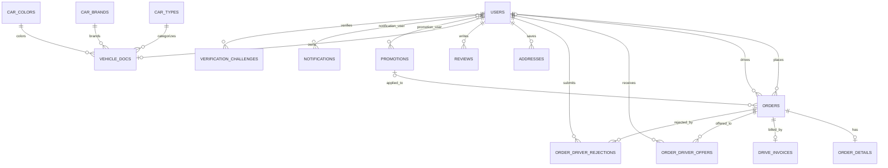

# Tawsela

Tawsela is a Laravel API for a driver-based ride service. It supports customer and driver accounts, ride requests and lifecycle management, driver location and availability, payment of driver balances, account verification, and administrative management of vehicle types, brands, promotions, and settings.

The API uses `/api` as its base path. A complete importable Postman collection is available at [`postman/collection.json`](postman/collection.json); it includes all 68 routes registered by `routes/api.php` and `routes/admin.php`, request inputs, and authentication setup.

## Features

- **Authentication and accounts:** phone and email verification challenges, password reset, Sanctum API tokens, Facebook/Google token-based sign-in, and role-aware registration for users and drivers.
- **Driver onboarding:** identity and vehicle documents, vehicle reference data, account activation, online status, and location updates.
- **Rides:** create and list rides, offer eligible rides to nearby drivers, accept/reject offers, record arrival and drive progress, cancel rides, and generate drive invoices.
- **Location and matching:** Redis GEO indexes and last-seen keys are used to find nearby drivers. Driver location updates are broadcast on the `current-location` channel.
- **Driver account and payments:** wallet summaries, balance tracking, and Stripe charges for driver balances.
- **Customer features:** saved addresses, reviews, promotions, notifications, and a support chat endpoint backed by Gemini.
- **Notifications:** database notifications and Firebase Cloud Messaging (FCM) push notifications; email and SMS verification are queued.
- **Administration:** manage vehicle types and brands, promotions, and application settings.
- **Scheduled operations:** reset driver daily hours, alert drivers about vehicle-license expiry, close accounts over the configured debit threshold, and cancel stale pending orders.

## Tech Stack

| Area | Implementation |
| --- | --- |
| Runtime | PHP `^8.1`; the Dockerfile uses PHP 8.1 CLI |
| Framework | Laravel Framework 10.28.0 in `composer.lock` (composer constraint `^10.10`) |
| Database | MySQL; Docker Compose uses MySQL 8.0 |
| Cache and queue | File cache and database queue by default; queue jobs are dispatched after transaction commits |
| Location | Redis through Predis, including Redis GEO commands |
| API authentication and roles | Laravel Sanctum and Spatie Laravel Permission |
| Translations and media | Astrotomic Laravel Translatable and Spatie Media Library |
| API formatting | Spatie Fractal |
| External services | Firebase FCM, Vonage SMS/Voice, Stripe, Laravel Socialite providers, and Gemini API |
| Broadcast events | Laravel broadcasting; the sample `.env` uses the `log` broadcaster, and Pusher is available when configured |
| Tests | PHPUnit 10.4.1; Laravel's test runner |
| Optional frontend assets | Vite 4 and Laravel Vite Plugin; Node.js/npm are only needed to build or serve these assets |

The versions above are taken from the lock file where available. Redis and external services need to be provisioned separately; Docker Compose only defines the application, queue worker, MySQL, and phpMyAdmin containers.

## Requirements

For a local non-Docker setup:

- PHP 8.1 or newer, with the extensions installed by the Dockerfile: `curl`, `mbstring`, `exif`, `fileinfo`, `pdo_mysql`, and `zip`.
- Composer.
- MySQL 8.0 or a compatible MySQL server.
- Redis with GEO command support for driver locations and proximity-based order offers.
- A queue worker for background jobs.
- Node.js and npm only if you need to build or serve the Vite assets.
- Credentials and reachable services for whichever integrations you enable (mail, Vonage, Firebase, Stripe, social login, Gemini, or Pusher).

## Installation and Setup

### Local development

1. Clone the repository and enter the project directory:

   ```bash
   git clone <repository-url> tawsela
   cd tawsela
   ```

2. Install PHP dependencies:

   ```bash
   composer install
   ```

3. Create the environment file:

   ```bash
   cp .env.example .env
   ```

   In PowerShell, use `Copy-Item .env.example .env`.

4. Create a local MySQL database and configure the `DB_*` values in `.env`. The example defaults to MySQL at `127.0.0.1:3306` with database name `tawsela` and a local `root` account. Change the username/password to match your MySQL setup.

   Example SQL:

   ```sql
   CREATE DATABASE tawsela CHARACTER SET utf8mb4 COLLATE utf8mb4_unicode_ci;
   ```

5. Generate the Laravel application key:

   ```bash
   php artisan key:generate
   ```

6. Run migrations and seed the development reference data:

   ```bash
   php artisan migrate --seed
   ```

   Use this on a fresh local database. `DatabaseSeeder` seeds roles, vehicle reference values, VAT settings, and an admin account. The seeders delete and recreate some reference rows, so do not run them against data you need to preserve. Review and replace the seeded admin credential before exposing the app beyond an isolated local environment.

7. Create the public storage link for uploaded media:

   ```bash
   php artisan storage:link
   ```

8. Configure and start Redis. The sample `.env` points to `127.0.0.1:6379`. Driver location updates and nearby-driver lookup use Redis, so those workflows require a reachable Redis service.

9. Start the application and queue worker in separate terminals:

   ```bash
   php artisan serve
   ```

   ```bash
   php artisan queue:work database --tries=5 --timeout=120 --sleep=3
   ```

   The application is available at `http://127.0.0.1:8000` by default. The database queue requires migrations to have created the `jobs` and `failed_jobs` tables.

10. If you need the Vite assets, install the JavaScript dependencies and start the development build:

    ```bash
    npm install
    npm run dev
    ```

    For a production asset build, use `npm run build`.

### Docker Compose

Docker Compose defines the Laravel app, a database queue worker, MySQL 8.0, and phpMyAdmin. It does **not** define Redis or Mailpit.

1. Copy `.env.example` to `.env` and set values usable from containers. In particular, use the MySQL service hostname rather than loopback:

   ```dotenv
   DB_CONNECTION=mysql
   DB_HOST=mysql
   DB_PORT=3306
   DB_DATABASE=tawsela
   DB_USERNAME=tawsela
   DB_PASSWORD=tawsela
   MYSQL_ROOT_PASSWORD=root
   QUEUE_CONNECTION=database
   ```

   Compose uses `DB_DATABASE`, `DB_USERNAME`, and `DB_PASSWORD` to initialize the MySQL service as well as the application's environment. Adjust these values together if you choose different credentials. Configure `REDIS_HOST` to a separately provisioned Redis host reachable from the containers if using location matching.

2. Build and start the containers:

   ```bash
   docker compose up --build -d
   ```

3. Generate the app key, migrate, seed, and create the storage link:

   ```bash
   docker compose exec app php artisan key:generate
   docker compose exec app php artisan migrate --seed
   docker compose exec app php artisan storage:link
   ```

4. Open the services:

   | Service | Address |
   | --- | --- |
   | Laravel app | `http://localhost:8000` |
   | phpMyAdmin | `http://localhost:8080` |
   | MySQL from host tools | `127.0.0.1:3307` |
   | MySQL from app/worker containers | `mysql:3306` |

The app and queue worker mount the project directory, a named `vendor` volume, and a named `storage_data` volume. The worker runs `queue:work database --tries=5 --timeout=120 --sleep=3`.

Useful commands:

```bash
docker compose ps
docker compose logs -f app queue-worker
docker compose exec app php artisan migrate:status
docker compose down
```

The Docker image installs PHP extensions listed in the Dockerfile and runs as an unprivileged `laravel` user. Mail delivery still needs a reachable SMTP service; the sample `.env.example` uses `mailpit`, but Compose does not start a Mailpit container.

## Environment Configuration

Copy `.env.example` to `.env` and supply only the credentials for integrations you enable. Do not commit `.env`, API keys, Firebase service-account JSON, or Vonage private keys.

| Variables | Purpose |
| --- | --- |
| `APP_NAME`, `APP_ENV`, `APP_KEY`, `APP_DEBUG`, `APP_URL` | Laravel application identity, encryption key, environment, debugging, and public URL. Keep `APP_DEBUG=false` outside local development. |
| `DB_CONNECTION`, `DB_HOST`, `DB_PORT`, `DB_DATABASE`, `DB_USERNAME`, `DB_PASSWORD` | Database connection. Use `DB_HOST=mysql` inside Docker Compose and a local host such as `127.0.0.1` for a local PHP process. |
| `CACHE_DRIVER`, `SESSION_DRIVER`, `QUEUE_CONNECTION` | The example uses `file`, `file`, and `database`, respectively. Jobs require a running worker. |
| `REDIS_HOST`, `REDIS_PORT`, `REDIS_PASSWORD` | Redis connection for driver location GEO storage and nearby matching. |
| `MAIL_MAILER`, `MAIL_HOST`, `MAIL_PORT`, `MAIL_USERNAME`, `MAIL_PASSWORD`, `MAIL_ENCRYPTION`, `MAIL_FROM_ADDRESS`, `MAIL_FROM_NAME` | SMTP configuration for queued verification email. The sample host `mailpit` is not provided by Compose. |
| `VONAGE_API_KEY`, `VONAGE_API_SECRET_KEY` | Vonage SMS API credentials. |
| `VONAGE_APPLICATION_ID` and `private.key` | Vonage voice call configuration. The voice service reads `private.key` relative to the project root; provide it securely at runtime and keep it outside the public web root and version control. |
| `FIREBASE_PROJECT_ID`, `FIREBASE_SERVICE_ACCOUNT_PATH` | FCM HTTP v1 project and service-account JSON path. The example uses `storage/firebase/firebase-adminsdk.json`; the JSON file must be provided locally and must not be committed. |
| `STRIPE_SECRET` | Stripe secret used by the driver's balance-charge endpoint. `STRIPE_KEY` is also present in Laravel's services config, but the current payment controller reads `STRIPE_SECRET`. |
| `GEMINI_API_KEY` | API key used by the support chat integration. |
| `FACEBOOK_CLIENT_ID`, `FACEBOOK_CLIENT_SECRET`, `GOOGLE_CLIENT_ID`, `GOOGLE_CLIENT_SECRET` | Socialite provider credentials for social authentication flows. |
| `BROADCAST_DRIVER`, `PUSHER_APP_ID`, `PUSHER_APP_KEY`, `PUSHER_APP_SECRET`, `PUSHER_HOST`, `PUSHER_PORT`, `PUSHER_SCHEME`, `PUSHER_APP_CLUSTER` | Broadcasting configuration. The sample uses `BROADCAST_DRIVER=log`; set up a compatible broadcaster and credentials to deliver location events to clients. |
| `AUTH_VERIFICATION_CODE_EXPIRY`, `AUTH_VERIFICATION_MAX_ATTEMPTS` | Verification challenge expiry in minutes and maximum verification attempts. The defaults in `config/auth.php` are 10 minutes and 5 attempts. |

Some integration variables are not listed in `.env.example` and must be added to `.env` when those features are used. Never place real secrets in this README or source control.

## Project Architecture

The application follows Laravel's conventional routing, controller, request-validation, service, and Eloquent model structure. It does not implement a repository layer.

| Location | Responsibility |
| --- | --- |
| `routes/api.php`, `routes/admin.php` | Register API endpoints and group them by API version, role, and middleware. `RouteServiceProvider` loads both under `/api`. |
| `app/Http/Controllers/Api` | Handle HTTP requests and responses for authentication, user, driver, and admin modules. |
| `app/Http/Requests` | Validate request bodies for endpoints that use Form Request classes. A few controller inputs are read directly and do not have validation rules; see the Postman collection descriptions. |
| `app/Services` | Encapsulate authentication, order lifecycle, driver location, address, chat, Firebase, and Vonage call operations. |
| `app/Models` | Eloquent records and relationships for users, orders, promotions, vehicle data, addresses, invoices, and notifications. |
| `app/Http/Middleware` | Enforce Sanctum authentication, admin/driver/user roles, and driver account-open status. |
| `app/Jobs`, `app/Events`, `app/Listeners` | Queue external email/SMS/push work and connect domain events to background work. |
| `app/Transformers` | Shape API resources through Fractal transformers. |

Important implementation patterns include:

- **Dependency injection and interfaces:** services are resolved through Laravel's container. `AiServiceInterface` maps to the Gemini service; `OrderCancellation` maps to a notification decorator around `OrderService`.
- **Pipeline:** order creation uses Laravel's Pipeline to assemble VAT, persist an order and details, and calculate eligible drivers.
- **Decorator:** the cancellation decorator adds a notification to the order-cancellation service.
- **Events and listeners:** `OrderCreated` schedules offer notifications, `UserVerified` schedules a driver welcome notification, and `PickLocation` broadcasts location updates immediately.
- **Role-based access:** Sanctum protects authenticated routes; Spatie roles distinguish `user`, `driver`, and `admin`. Driver document/order routes additionally use `is_account_opened` where configured.

### Request lifecycle

1. Laravel routes the request through the API middleware group and any route-specific authentication/role/account middleware.
2. Form Requests validate defined inputs before the controller runs. Endpoints without a Form Request may validate inline or read request values directly.
3. Controllers call services and return the application's standard response envelope or transformed data.
4. Services perform database work through Eloquent and transactions as needed. Domain events may then dispatch queue jobs or broadcasts.
5. Queued jobs perform external delivery. The queue connections are configured to wait for database commits before dispatching jobs where applicable.

## Database

Migrations define the core ride-hailing data, Spatie role/permission tables, Sanctum tokens, media, queue tables, and verification challenges. MySQL is the configured default. Important entities and application relationships include:

- `users` represents customers and drivers; Spatie roles attach `user`, `driver`, or `admin` roles. Drivers may have a `vehicle_docs` record and multiple location picker records.
- `orders` belongs to a customer and may belong to a driver and promotion. An order has order details and a drive invoice in the Eloquent model, and has many driver offers and rejections.
- `order_driver_offers` and `order_driver_rejections` connect orders and drivers. Each table enforces one row per order/driver pair.
- `drive_invoices` records ride price, taxes, total, waiting amount, customer, driver, and order.
- `addresses` and `reviews` belong to users; reviews also reference a driver.
- `promotions` are attached to users through `promotion_user` and can be referenced by orders. `notifications` connect to users through `notification_user` and have translated text.
- Vehicle reference data is stored in `car_types`, `car_brands`, and `car_colors`; translated names live in their translation tables.
- `verification_challenges` stores hashed codes, purpose, destination, expiry, and attempt/consumption state.



The diagram summarizes model relationships. Some legacy migrations do not enforce every relationship shown with a database foreign key.

Database commands:

```bash
php artisan migrate
php artisan migrate:status
php artisan db:seed
php artisan migrate:fresh --seed
```

`migrate:fresh` drops all tables; use it only on a disposable development/test database. The `DatabaseSeeder` creates a local admin account with a hard-coded seed password. Change that seeder credential before using seeded accounts outside isolated development.

## API Documentation

All API routes are prefixed by `/api`. Most versioned routes use `/api/v1`; the driver order rejection endpoint is `/api/driver/orders/{order}/reject` without the `v1` segment.

The importable [Postman collection](postman/collection.json) documents all **68 endpoints**, including HTTP method, path variables, query parameters, body fields, content type, and Bearer token configuration. It defines collection variables `base_url` and `token`. Unauthenticated authentication endpoints override the collection-level Bearer token.

| Module | Routes included |
| --- | --- |
| Authentication | Registration, verification, password reset, login, logout, profile update, and social login |
| Account settings | Voice-alert toggle, notification-preference toggle, and profile retrieval |
| Driver account | Driver/vehicle documents, location, availability, driver details, and vehicle reference data |
| Driver orders | Pending offers, accept/reject, call customer, cancel, arrival, start/finish/complete, order details, and invoice |
| Driver drives and wallet | Drive dates/history, notifications, and wallet totals |
| Driver payments | Stripe balance charge |
| User | Chat, addresses, vehicles, orders, reviews, notifications, and promotions |
| Admin | Car types, car brands, promotions, and settings |

Authentication and authorization are route-specific: public auth endpoints do not require a token; most `/api/v1` application endpoints require Sanctum; user and driver routes also check their role; admin routes require the `admin` role; and driver onboarding/ride endpoints in the account-open group require an open driver account. See the collection for endpoint-level details and known route-handler caveats.

To inspect registered routes from a configured Laravel environment:

```bash
php artisan route:list --path=api
```

## Background Processing

The default queue connection is `database` and its configuration sets `after_commit=true`. Run migrations before starting a worker. The queue worker is not optional for email/SMS/push delivery in normal application use.

```bash
php artisan queue:work database --tries=5 --timeout=120 --sleep=3
```

Docker Compose starts a `queue-worker` service with the same command. Use `docker compose logs -f queue-worker` to inspect it. Failed queue jobs are stored in `failed_jobs` when the configured failed-job driver is available.

Important asynchronous work:

| Job/event | Work |
| --- | --- |
| `SendVerificationEmail` | Deliver verification email |
| `SendSms` | Deliver verification SMS through Vonage |
| `SendFirebaseNotification` | Deliver push notification through FCM |
| `SendOrderNotification` → `SendDriverOrderNotification` | Fan out a new order to one retryable job per eligible driver |
| `SendLicenseAlert` | Send vehicle-license expiry push notifications |
| `SendDriverWelcomeNotification` | Notify a driver after account verification |
| `OrderCreated` | Triggers the new-order notification fan-out |
| `UserVerified` | Triggers the driver welcome notification listener |

Notification/SMS/email jobs define up to five attempts with backoff intervals of 10, 30, 60, and 120 seconds. The queue connection's `retry_after` for the database driver is 180 seconds. A job that sends to a group may retry the group; new-order driver alerts are isolated by driver.

Scheduled commands are declared in `app/Console/Kernel.php`. In production, add Laravel's scheduler to cron:

```cron
* * * * * cd /path/to/tawsela && php artisan schedule:run >> /dev/null 2>&1
```

The schedule runs daily-driver-hours reset at midnight, license alerts at 13:41, account debit checks at 10:51, and pending-order cancellation hourly. The account debit command closes driver accounts when debit exceeds 2,000. The cancellation command's description says five minutes, while its query actually cancels pending orders older than 120 minutes.

For local development, the scheduler can be run with:

```bash
php artisan schedule:work
```

## Testing

Tests use PHPUnit 10 and are split into `Unit` and `Feature` suites as configured in `phpunit.xml`. The project includes authentication/password-reset, order creation/cancellation, and driver-order behavior tests.

Run the suite with either command:

```bash
php artisan test
```

```bash
vendor/bin/phpunit
```

The PHPUnit configuration sets the queue to `sync`, mail to `array`, and cache to `array`. It does not select an in-memory SQLite database; the SQLite settings are commented out. Configure a disposable test database via `.env.testing` or environment variables before running tests. Since the synchronous queue executes jobs inline, tests that invoke verification delivery can reach configured external services unless those jobs/services are faked or mocked.

## Docker Setup

The repository includes a multi-stage PHP 8.1 Dockerfile and `docker-compose.yml` services:

| Container | Responsibility | Ports/notes |
| --- | --- | --- |
| `app` | Laravel development server | Host port `8000` to container port `8000` |
| `queue-worker` | Processes database-backed jobs | No published port |
| `mysql` | MySQL 8.0 database | Host port `3307`, container port `3306`; data in `mysql_data` volume |
| `phpmyadmin` | Database UI | Host port `8080`; connects to `mysql:3306` |

The app and worker mount the source, `vendor`, and `storage`; MySQL data persists in the `mysql_data` named volume. Redis, SMTP/Mailpit, and the external API services are not Docker Compose services in this repository.

```bash
docker compose up --build -d
docker compose exec app php artisan migrate --seed
docker compose logs -f app queue-worker
docker compose down
```

`docker compose down -v` also deletes the named database/storage/vendor volumes; use it only when you intend to discard those persisted files.

## Troubleshooting

- **App container cannot connect to MySQL:** set `DB_HOST=mysql` in `.env` for Compose. `127.0.0.1` inside the app container refers to the app container itself.
- **Nearby-driver/order matching fails:** start/configure Redis and make sure `REDIS_HOST` is reachable. Compose does not create a Redis container.
- **Queued messages are not delivered:** confirm `QUEUE_CONNECTION=database`, migrations have created `jobs`, and a queue worker is running. After changing queue config, restart long-lived workers.
- **Email jobs fail:** configure a reachable SMTP host. The sample uses `mailpit`, which is not included in Compose.
- **Push notifications fail:** check the Firebase project ID and service-account JSON path from the app and queue worker environments; verify the account file is present and readable.
- **Media is missing from public URLs:** run `php artisan storage:link` and confirm the configured public storage disk is writable.
- **External login/payment/chat is unavailable:** check the relevant provider credentials; social login, Stripe, Vonage, and Gemini require external service configuration.
- **Seed command fails on existing data:** use a fresh disposable development database. Several reference-data seeders delete existing rows before reseeding.

## Known Implementation Gaps

- Verification challenge issuance currently uses a constant code; random generation is commented out in `VerificationChallengeService`. Replace this behavior before production use.
- The admin promotion-details route points to `PromotionController@show`, but that method is not implemented.
- The car-type details handler is empty. The car-brand details route is registered to that same empty `CarTypeController@show` handler.
- The scheduled stale-order cancellation command description says five minutes, but the query uses a 120-minute age threshold.

These routes remain in the API route files and in the Postman collection; the README does not treat them as working features.
